<!-- ui-diff:sticky id=default -->
### UI diff — 4 changed, 0 unchanged

**Base** `6737326` → **Head** `cc13cab` · 1 route · desktop, mobile · light, dark

#### Summary

**What changed**
- **Primary button**: padding 8×14 → 10×18px and corner radius 4 → 8px. The button is a few pixels wider and taller, so "See how it works" sits slightly further right and the rest of the page moves down 4px (desktop height 1603 → 1607px). That shift is aligned in the diff and is not counted as a restyle.
- **Hero actions**: the gap between the button and the secondary link is 16 → 17px.
- **Newsletter label**: "Work email" is brand blue (`#2563eb`). Its weight is unchanged.

**Worth a look**
- In dark mode the label is 3.45:1 (`#2563eb` on `#0f172a`), short of 4.5:1. Light mode passes.
- The new spacing is off the token scale: `10px` and `18px` on the button (nearest 8px and 16px) and `17px` on the hero actions (nearest 16px).

**Not checked:** `/about.html` (its files did not change).

#### Changes

**`/`** · desktop · light — 0.34% of pixels changed · 2 areas · content shifted down 4px (unchanged, not counted) · page height 1603 → 1607px

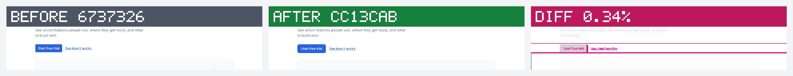

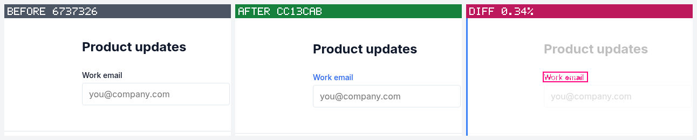

Full page

**`/`** · desktop · dark — 0.34% of pixels changed · 2 areas · content shifted down 4px (unchanged, not counted) · page height 1603 → 1607px

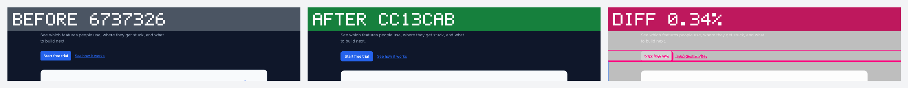

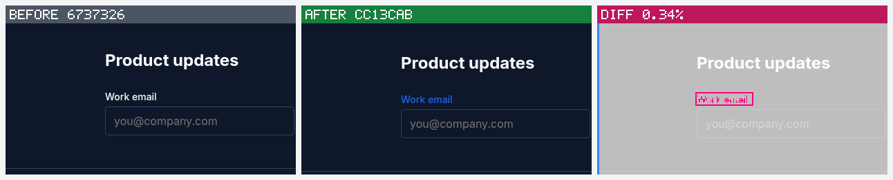

Full page

**`/`** · mobile · light — 0.40% of pixels changed · 2 areas · content shifted down 4px (unchanged, not counted) · page height 1936 → 1940px

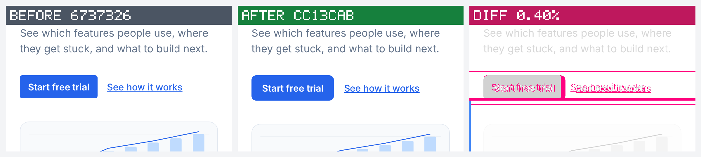

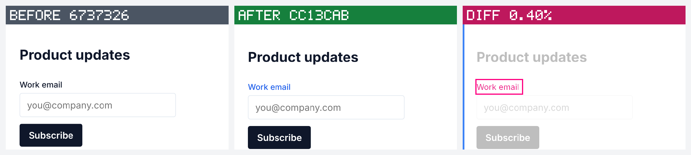

Full page

**`/`** · mobile · dark — 0.40% of pixels changed · 2 areas · content shifted down 4px (unchanged, not counted) · page height 1936 → 1940px

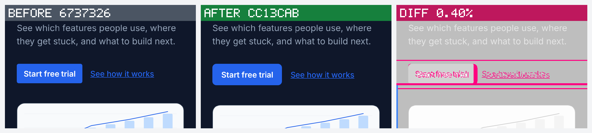

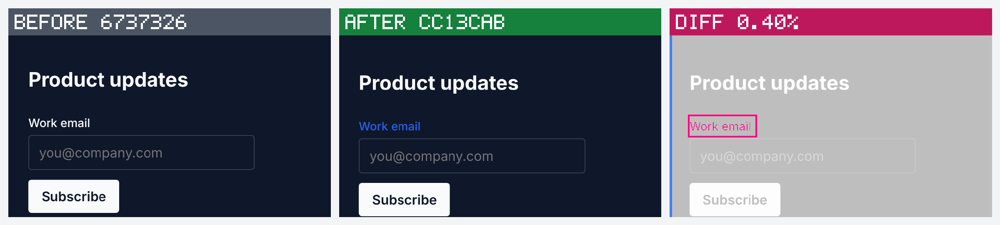

Full page

#### Variants

**`/` · desktop · light** — compare `?hero=` and pick one

<table><tr>
<th>hero=1</th>
<th>hero=2</th>
<th>hero=3</th>
<th>hero=4</th>
</tr><tr>
<td valign="top"></td>
<td valign="top"></td>
<td valign="top"><a href="variants/home__desktop__light__hero-3.png">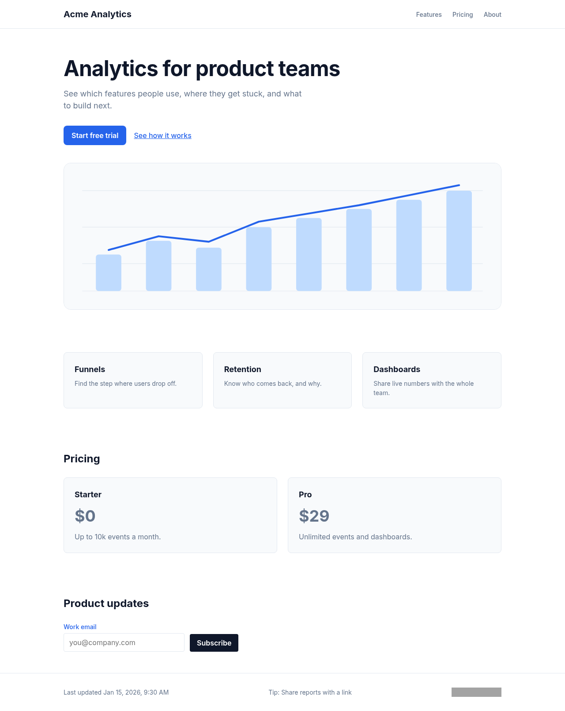</a></td>
<td valign="top"><a href="variants/home__desktop__light__hero-4.png">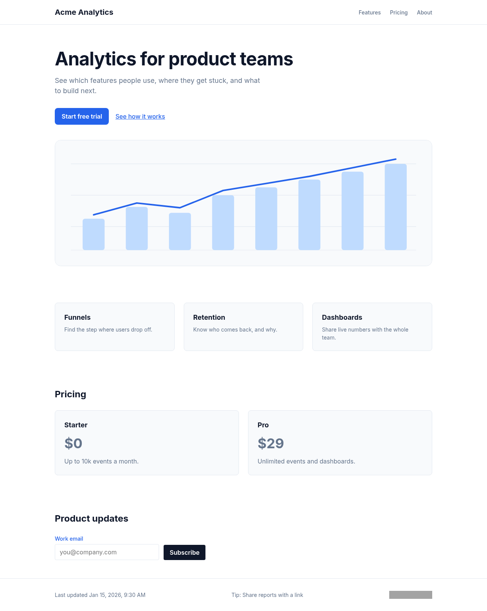</a></td>
</tr></table>

- [ ] `hero=1` <!-- ui-diff-pick:home:desktop:hero=1 -->
- [ ] `hero=2` <!-- ui-diff-pick:home:desktop:hero=2 -->
- [ ] `hero=3` <!-- ui-diff-pick:home:desktop:hero=3 -->
- [ ] `hero=4` <!-- ui-diff-pick:home:desktop:hero=4 -->

#### Motion

**`/`** · desktop — wait 400ms, hover .cta, wait 700ms, click [data-tab=yearly] (not on base), wait 900ms

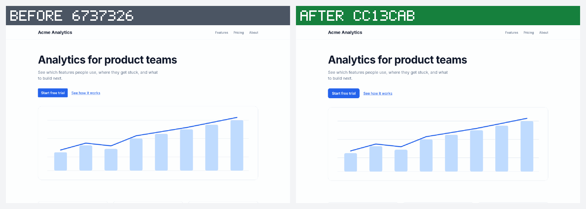

> ⚠️ no motion detected: the clip has a single frame on both sides (nothing animated during these steps)

[before.webm](motion/home__desktop__light__before.webm) · [after.webm](motion/home__desktop__light__after.webm)

#### Accessibility — 1 new, 0 fixed

| | Issue | Impact | Element | Where |
|---|---|---|---|---|
| New | [Elements must meet minimum color contrast ratio thresholds](https://dequeuniversity.com/rules/axe/4.14/color-contrast?application=axeAPI) `color-contrast` _(contrast)_ | serious | `label` | `/` desktop/dark, mobile/dark |

#### Design tokens — 3 new off-token values

| Property | Value | Nearest token | Elements |
|---|---|---|---|
| spacing | `17px` | `space.4 (16px)` | `div.hero-actions` |
| spacing | `10px` | `space.2 (8px)` | `a.cta` |
| spacing | `18px` | `space.4 (16px)` | `a.cta` |

Audited the changed areas of 4 captures.

ui-diff 0.1.0 · base `6737326` · head `cc13cab` · rendered locally — nothing uploaded · generated 2026-11-20 13:05:18 UTC
<!-- ui-diff:meta {"head":"cc13cab81ca4c056ebe8ed861cce6747f2495e59","base":"6737326b2e051665eb7b14a33d39acee32ff22de","createdAt":"2026-11-20T13:05:18.234Z"} -->
