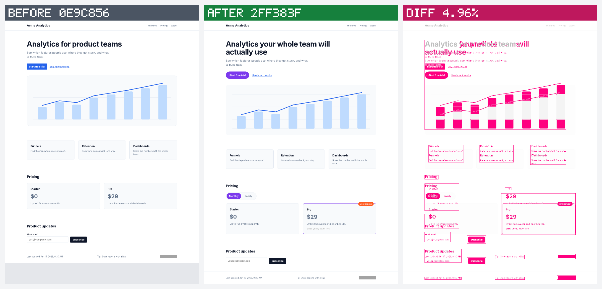
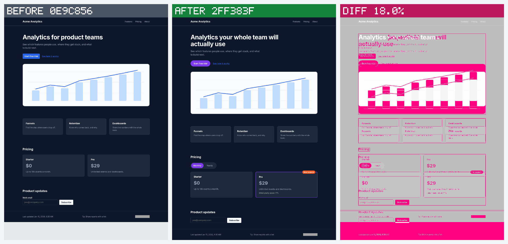
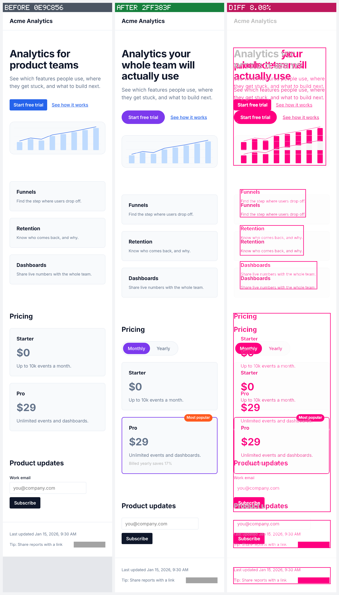
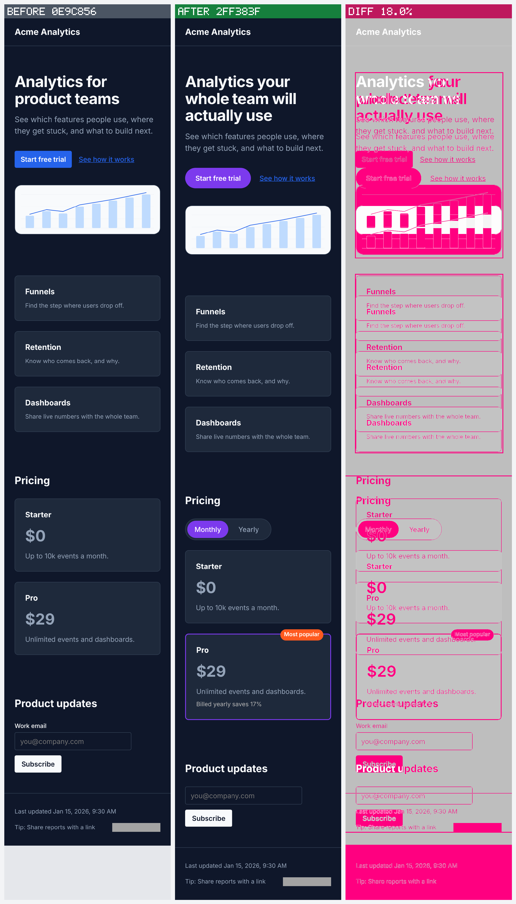
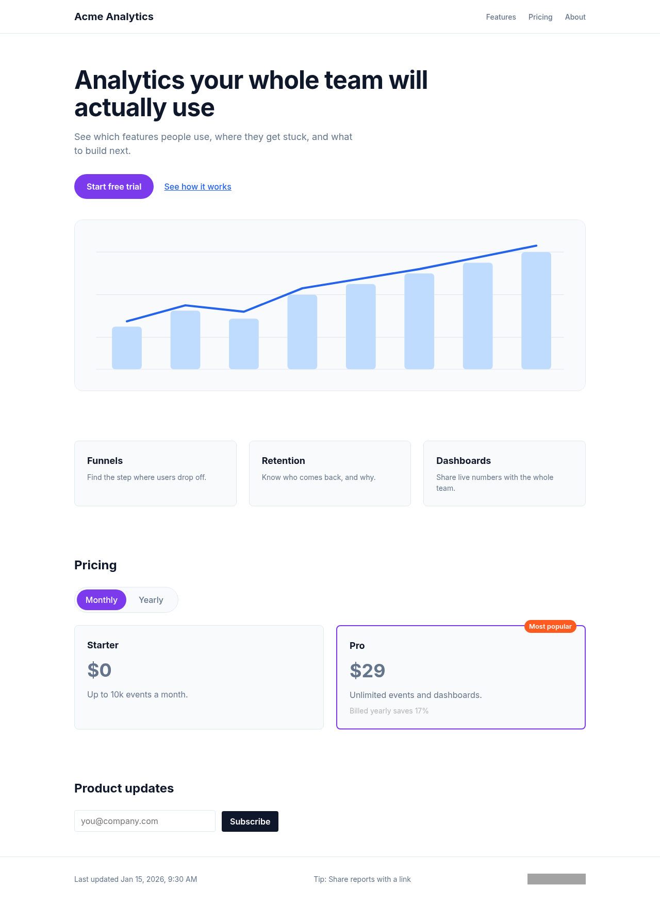
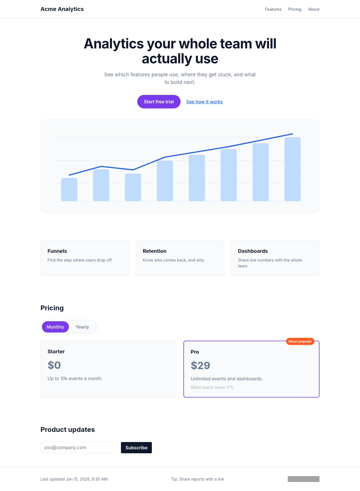

<!-- ui-diff:sticky id=default -->
### UI diff — 4 changed, 0 unchanged

**Base** `0e9c856` → **Head** `2ff383f` · 1 route · desktop, mobile · light, dark

#### Summary

**What changed**
- **Hero**: new headline, "Analytics your whole team will actually use". It wraps to two lines on desktop, which pushes everything below it down (page 1603 → 1744px tall); most of the 18% pixel change in dark mode is that shift, not a restyle of every section.
- **Primary CTA**: blue rectangle → violet pill (`#2563eb` → `#7c3aed`, radius 4 → 9999px, padding 8×14 → 12×24px) with a hover lift and glow (see the motion clip).
- **Pricing**: new Monthly/Yearly toggle with a sliding indicator (Pro drops to $24 on yearly), the Pro card gets a 2px violet border, a "Most popular" badge and a "Billed yearly saves 17%" note.
- **Newsletter**: the visible "Work email" label is gone; the field relies on its placeholder.
- **Hero variants**: four layouts are available via `?hero=1..4` (default, centered, dark band, split). Pick one below.

**Worth a look**
- The "Most popular" badge uses `#ff5a1f`, 13px text and 3×9px padding, none of which are tokens, and white on that orange is 3.1:1 (needs 4.5:1).
- The price note (`#b4b4b4` on the card) is 2.0:1 in light mode and is not a token color.
- The email field has `tabindex="1"`: keyboard focus now starts at the bottom of the page and then jumps back to the logo. Its accessible name changed from "Work email" to the placeholder "you@company.com".
- Fixed: the dashboard chart image now has alt text (axe `image-alt`).

**Not checked:** `/about.html` (its files and the shared `styles.css` did not change).

#### Changes

**`/`** · desktop · light — 4.96% of pixels changed · 18 areas · page height 1603 → 1744px

Full page

**`/`** · desktop · dark — 18.0% of pixels changed · 5 areas · page height 1603 → 1744px

**`/`** · mobile · light — 8.08% of pixels changed · 7 areas · page height 1936 → 2063px

**`/`** · mobile · dark — 18.0% of pixels changed · 4 areas · page height 1936 → 2063px

#### Variants

**`/` · desktop · light** — compare `?hero=` and pick one

<table><tr>
<th>hero=1</th>
<th>hero=2</th>
<th>hero=3</th>
<th>hero=4</th>
</tr><tr>
<td valign="top"></td>
<td valign="top"></td>
<td valign="top"></td>
<td valign="top"></td>
</tr></table>

- [ ] `hero=1` <!-- ui-diff-pick:home:desktop:hero=1 -->
- [ ] `hero=2` <!-- ui-diff-pick:home:desktop:hero=2 -->
- [ ] `hero=3` <!-- ui-diff-pick:home:desktop:hero=3 -->
- [ ] `hero=4` <!-- ui-diff-pick:home:desktop:hero=4 -->

#### Motion

**`/`** · desktop — wait 400ms, hover .cta, wait 700ms, click [data-tab=yearly] (not on base), wait 900ms

[before.webm](motion/home__desktop__light__before.webm) · [after.webm](motion/home__desktop__light__after.webm)

#### Accessibility — 3 new, 1 fixed

| | Issue | Impact | Element | Where |
|---|---|---|---|---|
| New | [Elements must meet minimum color contrast ratio thresholds](https://dequeuniversity.com/rules/axe/4.14/color-contrast?application=axeAPI) `color-contrast` _(contrast)_ | serious | `.badge` | `/` (all 4) |
| New | [Elements must meet minimum color contrast ratio thresholds](https://dequeuniversity.com/rules/axe/4.14/color-contrast?application=axeAPI) `color-contrast` _(contrast)_ | serious | `.price-note` | `/` desktop/light, mobile/light |
| New | [Elements should not have tabindex greater than zero](https://dequeuniversity.com/rules/axe/4.14/tabindex?application=axeAPI) `tabindex` _(focus)_ | serious | `#email` | `/` (all 4) |
| Fixed | [Images must have alternative text](https://dequeuniversity.com/rules/axe/4.14/image-alt?application=axeAPI) `image-alt` _(labels)_ | critical | `img` | `/` (all 4) |

**Focus order** on `/ desktop`: focus now jumps against reading order: textbox "you@company.com" → link "Acme Analytics"; tab order of existing controls changed; new tab stops: tab "Monthly", tab "Yearly"; accessible name changed: textbox "Work email" → "you@company.com".

Tab sequence

Before: link "Acme Analytics" → link "Features" → link "Pricing" → link "About" → link "Start free trial" → link "See how it works" → textbox "Work email" → button "Subscribe"

After: textbox "you@company.com" → link "Acme Analytics" → link "Features" → link "Pricing" → link "About" → link "Start free trial" → link "See how it works" → tab "Monthly" → tab "Yearly" → button "Subscribe"

**Focus order** on `/ mobile`: focus now jumps against reading order: textbox "you@company.com" → link "Acme Analytics"; tab order of existing controls changed; new tab stops: tab "Monthly", tab "Yearly"; accessible name changed: textbox "Work email" → "you@company.com".

Tab sequence

Before: link "Acme Analytics" → link "Start free trial" → link "See how it works" → textbox "Work email" → button "Subscribe"

After: textbox "you@company.com" → link "Acme Analytics" → link "Start free trial" → link "See how it works" → tab "Monthly" → tab "Yearly" → button "Subscribe"

#### Design tokens — 5 new off-token values

| Property | Value | Nearest token | Elements |
|---|---|---|---|
| background-color | `#ff5a1f` | — | `span.badge` |
| spacing | `3px` | `space.1 (4px)` | `span.badge` |
| spacing | `9px` | `space.2 (8px)` | `span.badge` |
| font-size | `13px` | `font.size.sm (14px)` | `span.badge` |
| color | `#b4b4b4` | `color.neutral.400 (#94a3b8)` | `p.price-note` |

ui-diff 0.1.0 · base `0e9c856` · head `2ff383f` · rendered locally — nothing uploaded · generated 2026-11-18 12:50:29 UTC
<!-- ui-diff:meta {"head":"2ff383fbc45b1d4b9aa9b8a7c576f8240274772b","base":"0e9c85691fd4e5a468e5a2f9826a976812e534ff","createdAt":"2026-11-18T12:50:29.851Z"} -->
